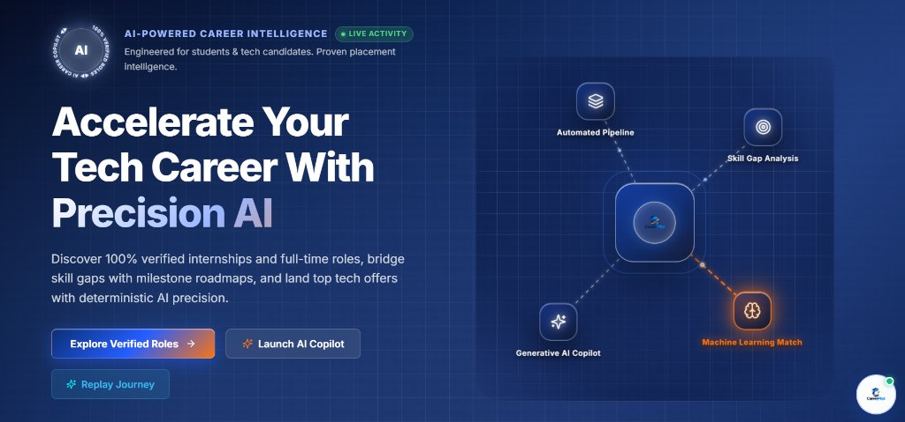
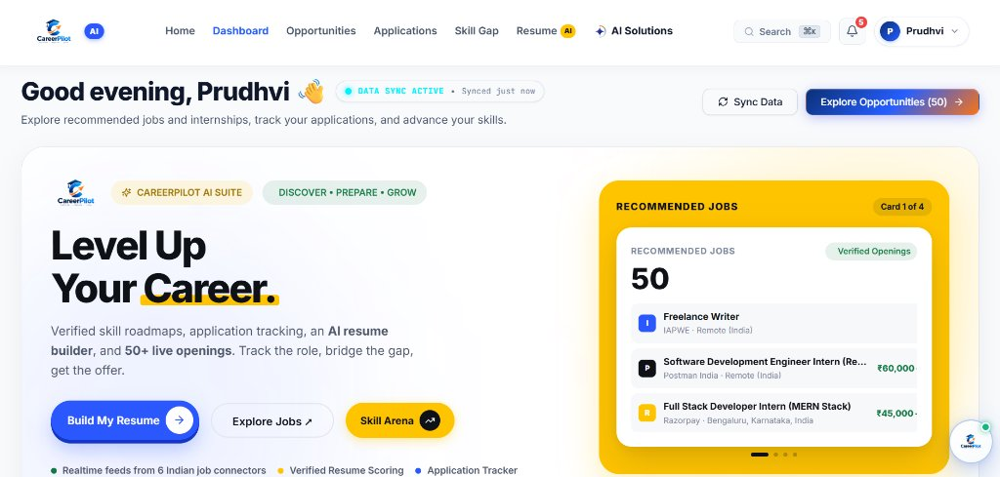
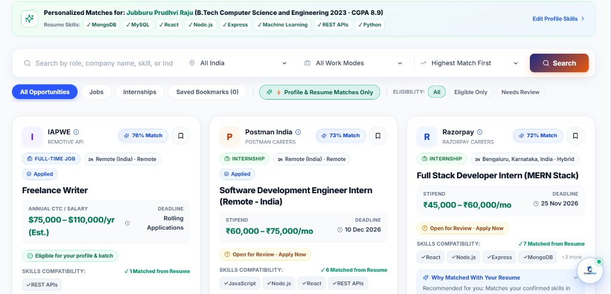
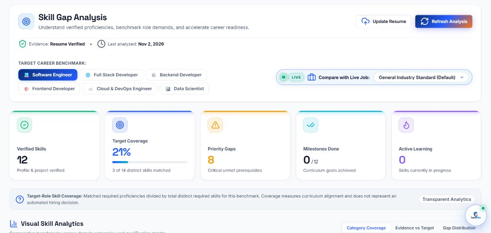
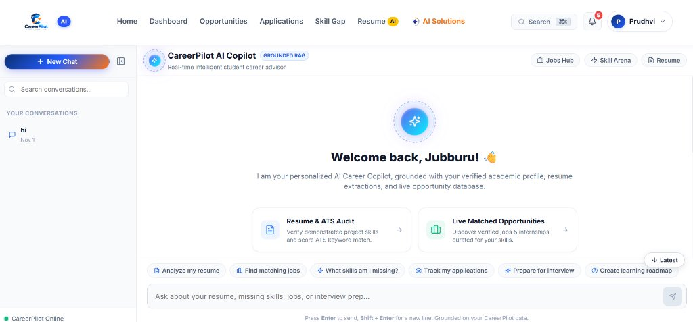
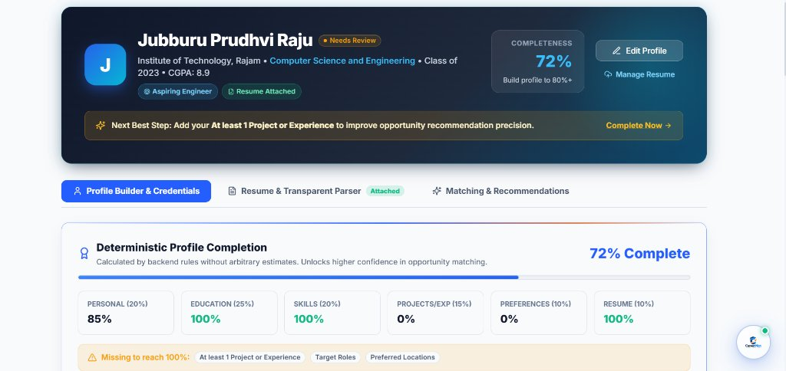

# CareerPilot AI — Autonomous Career Discovery & Student Readiness Platform

[](https://python.org)
[](https://flask.palletsprojects.com/)
[](https://react.dev/)
[](https://vitejs.dev/)
[](https://www.mongodb.com/)
[](LICENSE)

**CareerPilot AI** is an intelligent, event-driven career opportunity discovery and student readiness platform built specifically for university engineering students and early-career software engineers.

The platform runs 100% on **REAL MongoDB collections** and **LIVE, continuously refreshed external ingestion pipelines** (Unstop, Devfolio, Codeforces, Remotive, ATS boards) with real-time Server-Sent Events (SSE) updates, deterministic academic eligibility validation, evidence-based skill-gap analysis, an interactive 200-question exam arena, a voice-enabled AI Interview Simulator, and a RAG-grounded AI Career Copilot — with **zero mock or fixture data in production code**.

---

## 📸 Platform Interface & Visual Tour

### 1. Landing Page & AI Architecture Constellation
> *AI-powered career intelligence designed for students and tech candidates, mapping automated pipelines, skill-gap analysis, and generative AI copilots.*



---

### 2. Student Dashboard & Personalized Opportunity Deck
> *Real-time student dashboard displaying live sync telemetry, the Abekus Hero Deck, profile completion score, and verified job recommendations with salary/stipend breakdowns.*



---

### 3. Personalized Opportunities Feed & Hard Eligibility Badging
> *Live opportunity cards featuring match percentages, strict academic eligibility checks (batch, degree, CGPA), work mode filters, and skill compatibility tags.*



---

### 4. Evidence-Based Skill Gap Analysis
> *Target role benchmark arena comparing verified candidate skills against industry standards across 7 canonical categories, identifying priority gaps and milestone roadmaps.*



---

### 5. Grounded RAG AI Career Copilot
> *Conversational AI Career Advisor with dynamic database context retrieval, prompt injection defense, quick prompt chips, and token-by-token streaming via Server-Sent Events.*



---

### 6. Profile Builder & Deterministic Completeness
> *Comprehensive student profile tracking academic credentials, verified skills, project history, and section-by-section completion metrics with manual edit protection.*



---

## 📑 Table of Contents

- [The Big Picture: What is CareerPilot AI?](#-the-big-picture-what-is-careerpilot-ai)
- [Problems Solved vs. Solution Mapping](#-problems-solved-vs-solution-mapping)
- [Complete Master Technology Stack](#-complete-master-technology-stack)
- [AI, LLM, RAG & Machine Learning Deep Dive](#-ai-llm-rag--machine-learning-deep-dive)
- [System Architecture & Data Flow](#-system-architecture--data-flow)
- [Core Platform Capabilities](#-core-platform-capabilities)
- [Detailed Audit & Architectural Documentation](#-detailed-audit--architectural-documentation)
- [Installation & Developer Quick Start](#-installation--developer-quick-start)
- [Testing & Quality Verification](#-testing--quality-verification)
- [Project Directory Structure](#-project-directory-structure)
- [License & Contributions](#-license--contributions)

---

## 💡 The Big Picture: What is CareerPilot AI?

Imagine you are a 3rd or 4th-year college student preparing for placements:
- You check 10+ different websites every day (LinkedIn, Unstop, Devfolio, company careers pages).
- You spend 30 minutes reading a job post only to realize at the end that they require a 2024 graduation batch (and you graduate in 2026), or require an 8.5 CGPA (and you have an 8.0).
- Resumes get rejected by automated Applicant Tracking Systems (ATS) without human feedback.
- You freeze during technical interviews because you haven't practiced speaking out loud about your own project architecture.

**CareerPilot AI brings your entire career journey into one unified platform:**
1. **Live Discovery**: Continuously pulls engineering jobs, internships, hackathons, and coding contests from multiple platforms with an India-tech focus (Bengaluru, Hyderabad, Pune, Delhi NCR, etc.).
2. **Honest Eligibility Checks**: Decoupled from match scores — automatically evaluates deadlines, graduation year, degree branch, and CGPA with 0% false positives before you apply.
3. **Evidence-Based Skill Gaps**: Distinguishes between *demonstrated skills* (verified in projects and work experience) vs. *listed skills* (keywords typed on a resume).
4. **Interactive Practice**: Features a 200-question timed proctored exam arena and a speech-enabled AI Interview Simulator with 6-dimension rubric grading.
5. **RAG Career Copilot**: An intelligent conversational coach that knows your verified resume, projects, applications, and diagnosed skill gaps.

---

## ⚖️ Problems Solved vs. Solution Mapping

| Real Student Problem | How CareerPilot AI Solves It | Technical Implementation |
|---|---|---|
| **Scattered Opportunities** | Ingests listings into one centralized feed | Background connectors (Unstop, Devfolio, Remotive, Codeforces, ATS feeds) with 5-layer deduplication |
| **Unclear Eligibility Criteria** | Instantly flags eligible vs ineligible jobs | Deterministic Hard Eligibility Engine checking graduation batch, CGPA, and branch |
| **Resume & ATS Mismatches** | Scans resumes and extracts verified entities | Dual-format parsing (`pypdf` + `python-docx`) with Gemini AI and human-in-the-loop review mode |
| **Superficial Skill Matching** | Evaluates real project proof vs. buzzwords | Evidence-based qualification ($1.0$ Demonstrated, $0.75$ Coursework, $0.5$ Listed) |
| **Application Tracking Chaos** | Replaces spreadsheets with a visual pipeline | Drag-and-drop Kanban board (`@dnd-kit`) with status transitions and `.ics` calendar export |
| **Interview Nervousness** | Real verbal interview practice | Speech-to-text (Web Speech API) + 6-dimension AI rubric scoring (Technical, Clarity, STAR) |
| **Generic Chatbot Advice** | Context-aware, personalized guidance | Dynamic Context RAG injecting real candidate profile, projects, and active job applications |

---

## 🛠️ Complete Master Technology Stack

### 1. Frontend Layer (React 18 SPA)
- **Framework & Build**: React `18.3.1`, Vite `5.4.11`, React Router DOM `6.28.1`.
- **State & Data Caching**: TanStack React Query `5.104.1` for background cache revalidation.
- **Styling & Design System**: Custom design tokens (`frontend/src/index.css`), Lucide React icons (`0.475.0`).
- **Animations & Physics**: Framer Motion `14.0.0` for layout reveals, modal transitions, and living AI orbs.
- **Data Visualization**: Recharts `3.10.1` for skill radar charts and category breakdown graphs.
- **Drag-and-Drop**: `@dnd-kit/core` `6.3.1` and `@dnd-kit/sortable` `10.0.0` for Kanban pipeline management.
- **Real-Time Clients**: Native `fetch` reader for Server-Sent Events (SSE) and `socket.io-client` `4.8.4` for WebSockets.
- **Voice Machine Learning**: Browser Web Speech API (`SpeechRecognition` / `speechSynthesis`) for real-time voice dictation.

### 2. Backend Layer (Python & Flask)
- **Language & Runtime**: Python `3.12.5`.
- **API Framework**: Flask `>=3.0.0` utilizing the application factory pattern with 16 modular Blueprints.
- **WebSocket Engine**: Flask-SocketIO `>=5.3.6` managing real-time private rooms (`user_{user_id}`) and broadcasts.
- **Background Scheduler**: APScheduler `>=3.10.4` running non-blocking intervals for ingestion (6h), deadline checks (6h), and digests (24h).
- **Authentication & Security**: PyJWT `>=2.8.0` (HS256 tokens) and Werkzeug `>=3.0.0` (PBKDF2/SHA256 password hashing).
- **Document Extractors**: `pypdf` `>=4.0.0` (PDFs) and `python-docx` `>=1.0.0` (Word documents).
- **Network Client**: Requests `>=2.31.0` with circuit breaker policies and custom User-Agent headers.

### 3. Database & Storage Layer
- **Database Engine**: MongoDB `7.0+` (NoSQL Document Store).
- **Database Driver**: PyMongo `>=4.6.0` with centralized singleton connection pooling (`db.py`).
- **Collections (20)**: Dedicated models for `users`, `student_profiles`, `opportunities`, `applications`, `interview_prep_packs`, `mock_test_attempts`, `interview_sessions`, `copilot_conversations`, `notifications`, `source_runs`, `audit_logs`, etc.
- **Indexing Strategy**: Unique sparse indexes on `raw_hash`, compound indexes on `user_id + status`, `source.name + external_id`.
- **File Storage**: User-isolated local directories (`uploads/resumes/{user_id}/`).

---

## 🧠 AI, LLM, RAG & Machine Learning Deep Dive

CareerPilot AI uses a **hybrid multi-tier AI topology** to ensure 100% operational uptime without vendor lock-in.

```
                       ┌───────────────────────────────┐
                       │   Student Request / Prompt    │
                       └───────────────┬───────────────┘
                                       │
                                       ▼
                       ┌───────────────────────────────┐
                       │      Primary LLM Provider     │
                       │    Google Gemini 2.5 Flash    │
                       └───────────────┬───────────────┘
                                       │ (On 429 Quota / 401 Auth / Timeout > 15s)
                                       ▼
                       ┌───────────────────────────────┐
                       │    Secondary Fallback LLM     │
                       │       OpenAI GPT-4o-mini      │
                       └───────────────┬───────────────┘
                                       │ (If both APIs fail or offline)
                                       ▼
                       ┌───────────────────────────────┐
                       │ Deterministic Safety Fallback │
                       │    (Rule-Based JSON Engine)   │
                       └───────────────────────────────┘
```

### 1. Large Language Models (LLMs)
- **Primary Model: Google Gemini 2.5 Flash (`gemini-2.5-flash`)**
  - Invoked via `google-genai` SDK or `google.generativeai`.
  - Powers resume extraction, token-by-token chat streaming, interview question synthesis, and 6-dimension rubric grading.
- **Secondary Fallback: OpenAI GPT-4o-mini (`gpt-4o-mini`)**
  - Invoked via `openai` SDK with `response_format={"type": "json_object"}`.
  - Automatically takes over on rate limits (429), quota exhaustion, or timeouts (> 15s).
- **Deterministic Rule Generators**
  - Safety fallback that ensures the platform never crashes if cloud AI services are unreachable.

### 2. Retrieval-Augmented Generation (RAG) Architecture
- **Entity-Aware Dynamic Context RAG**: Pulls real-time structured facts from MongoDB (verified profile, projects, active applications, diagnosed skill gaps, live jobs).
- **Intent Classifier (`CareerIntentService`)**: Deterministic pattern classifier routing queries across 10 career intents (`OPPORTUNITY_ELIGIBILITY`, `SKILL_GAP_ANALYSIS`, `RESUME_QUERY`, `APPLICATION_QUERY`, etc.).
- **Prompt Injection Defense**: Boundary delimiter tags (`<<<UNTRUSTED_STUDENT_CONTEXT>>>` and `<<<UNTRUSTED_JOB_DESCRIPTION>>>`) with control character stripping and system override neutralization.
- **Streaming Protocol**: Token-by-token Server-Sent Events (`POST /api/copilot/stream`) with structured source attribution badges.

### 3. Machine Learning & Classical NLP Components
- **5-Layer Deduplication Engine**: Uses `difflib.SequenceMatcher` with a **$\ge 0.85$ similarity threshold** and SHA-256 fingerprinting to eliminate duplicate jobs across feeds.
- **Skill Normalization**: Translates raw tech aliases (`py`, `k8s`, `reactjs`, `postgres`) into canonical industry standards.
- **Evidence-Based Weighting Model**: Evaluates skill readiness using evidence multipliers:
  $$\text{Readiness Score} = \frac{\sum (1.0 \times \text{Demonstrated}) + (0.75 \times \text{Coursework}) + (0.5 \times \text{Listed})}{\sum \text{Target Role Requirements}} \times 100$$
- **5-Factor Recommendation Formula**:
  $$\text{Fit Score} = 0.35(S_{\text{skill}}) + 0.25(S_{\text{role}}) + 0.15(S_{\text{project}}) + 0.15(S_{\text{edu}}) + 0.10(S_{\text{location}})$$

---

## 🏛️ System Architecture & Data Flow

```
                                  ┌──────────────────────────────┐
                                  │      React 18 SPA Client     │
                                  │  (Vite + React Router + CSS) │
                                  └──────────┬────────┬──────────┘
                                             │        │ Server-Sent Events (SSE)
                                  HTTP/REST  │        │ /api/stream/opportunities
                                             ▼        ▼
┌────────────────────────────────────────────────────────────────────────────────────────┐
│                                Flask 3.1 Application Server                            │
│                                                                                        │
│   ┌─────────────────────┐   ┌──────────────────────────┐   ┌───────────────────────┐   │
│   │   Auth & Security   │   │  Opportunities Blueprint │   │  Applications Tracker │   │
│   │  (JWT + Refresh)    │   │  (Search, Save, Match)   │   │  (CRUD, Stages, Audit)│   │
│   └─────────────────────┘   └─────────────┬────────────┘   └───────────────────────┘   │
│                                           │                                            │
│   ┌─────────────────────┐   ┌─────────────┴────────────┐   ┌───────────────────────┐   │
│   │ Dashboard & Stats   │   │  Sources Telemetry       │   │  AI Career Copilot    │   │
│   │ (Real Mongo Counts) │   │  (Live Status & Sync)    │   │  (RAG Stream & Logs)  │   │
│   └─────────────────────┘   └─────────────┬────────────┘   └───────────────────────┘   │
│                                           │                                            │
│   ┌───────────────────────────────────────┴────────────────────────────────────────┐   │
│   │                         Ingestion & Live Connector Layer                       │   │
│   │                                                                                │   │
│   │   ┌───────────────────┐    ┌────────────────────┐    ┌─────────────────────┐   │   │
│   │   │ OpportunityService│    │  ProfileService    │    │  EventStreamManager │   │   │
│   │   └─────────▲─────────┘    └────────────────────┘    └─────────────────────┘   │   │
│   │             │                                                                  │   │
│   │   ┌─────────┴─────────┐    ┌────────────────────┐    ┌─────────────────────┐   │   │
│   │   │ Ingestion Pipeline│    │ APScheduler Daemon │    │ SHA-256 + Fuzzy     │   │   │
│   │   └─────────▲─────────┘    └────────────────────┘    │ Deduplicator        │   │   │
│   │             │                                        └─────────────────────┘   │   │
│   │   │ Live External Connectors (India Focus):                                │   │   │
│   │   │ • Unstop (India Tech)   • Devfolio (Hackathons)• Codeforces (Contests) │   │   │
│   │   │ • Remotive (Remote)     • Curated Indian Ecosystem Feeds               │   │   │
│   │   └────────────────────────────────────────────────────────────────────────┘   │   │
│   └───────────────────────────────────────┬────────────────────────────────────────┘   │
└───────────────────────────────────────────┼────────────────────────────────────────────┘
                                            │ PyMongo Driver
                                            ▼
┌────────────────────────────────────────────────────────────────────────────────────────┐
│                                MongoDB 7.0 Persistence                                 │
│  users • student_profiles • opportunities • applications • copilot_conversations       │
│  interview_sessions • mock_test_attempts • notifications • audit_logs (20 collections) │
└────────────────────────────────────────────────────────────────────────────────────────┘
```

---

## 🌟 Core Platform Capabilities

### 1. Opportunity Discovery & Ingestion Engine (India Tech Ecosystem Focus)
- **Live External Connectors**: Ingests real software engineering roles, internships, hackathons, and contests from Unstop, Devfolio, Codeforces, Remotive, and ATS boards. (See [`docs/sources.md`](file:///d:/careerpilot_ai/docs/sources.md) for details).
- **India Tech Mission & Hub Normalization**: Automatically normalizes locations to major Indian tech hubs (Bengaluru, Hyderabad, Pune, Delhi NCR, Noida, Mumbai, Chennai) with real INR (`₹`) stipends and salaries.
- **Strict India Eligibility Filtering (`is_india_eligible`)**: Actively rejects foreign-exclusive listings (USA-only, Europe-only), ensuring every opportunity is open to Indian candidates.
- **Automated Lifecycle Expiration**: Built-in background engine marks opportunities with past deadlines as `expired`.

### 2. Student Profile & Resume Provenance
- **Field-Level Provenance (`field_sources`)**: Every attribute in a student's profile tracks its exact origin (`manual`, `resume`, or `system`) along with updated timestamps.
- **Manual-Field Protection**: User-verified edits are safeguarded from being overwritten by subsequent automated resume parsers.
- **Dual-Engine Resume Parser**: Text extraction from both PDF (`pypdf`) and Word DOCX (`python-docx`), analyzed via Google Gemini AI for ATS scoring, skills, and projects.

### 3. Applications Pipeline & Kanban Tracker
- **Stage Progression**: Full drag-and-drop CRUD tracking across `Saved`, `Applied`, `Interviewing`, `Offer`, and `Rejected`.
- **Timeline & Notes**: Automatic audit event logging for status changes, dates, notes, and offer confetti triggers.
- **Calendar Synchronization**: Export upcoming deadlines and interview schedules to `.ics` files.

### 4. Proctored Mock Test Arena & AI Interview Simulator
- **200-Question Exam Arena**: Timed test portal with anti-cheating tab-switch detection, randomized choices, and weak-topic diagnostics.
- **AI Interview Simulator**: Interactive speech-to-text (Web Speech API) practice simulating Technical, Coding, Project Deep-Dive, and Behavioral tracks with 6-dimension rubric grading.

### 5. Cascading Privacy & Account Purge
- Permanent, staged account deletion across 14 personal collections, physical disk file removal, Socket.IO disconnect, and anonymized audit logging (compliant with GDPR & DPDP standards).

---

## 📚 Detailed Audit & Architectural Documentation

The project includes an exhaustive, professional 10-document system audit located in [`docs/project-audit/`](file:///d:/careerpilot_ai/docs/project-audit):

1. [**`CAREERPILOT_PROJECT_OVERVIEW.md`**](file:///d:/careerpilot_ai/docs/project-audit/CAREERPILOT_PROJECT_OVERVIEW.md): Executive project explanation, problem-to-solution mapping, and system boundaries.
2. [**`CAREERPILOT_SYSTEM_ARCHITECTURE.md`**](file:///d:/careerpilot_ai/docs/project-audit/CAREERPILOT_SYSTEM_ARCHITECTURE.md): Complete technical architecture, communication protocols, and **12 production Mermaid diagrams**.
3. [**`CAREERPILOT_FEATURE_DOCUMENTATION.md`**](file:///d:/careerpilot_ai/docs/project-audit/CAREERPILOT_FEATURE_DOCUMENTATION.md): Complete inventory of all features across Areas A through M.
4. [**`CAREERPILOT_API_DOCUMENTATION.md`**](file:///d:/careerpilot_ai/docs/project-audit/CAREERPILOT_API_DOCUMENTATION.md): Comprehensive REST API catalog with synthetic request/response schemas.
5. [**`CAREERPILOT_DATABASE_DICTIONARY.md`**](file:///d:/careerpilot_ai/docs/project-audit/CAREERPILOT_DATABASE_DICTIONARY.md): Master data dictionary for all 20 MongoDB collections and Mermaid ERD.
6. [**`CAREERPILOT_SECURITY_AUDIT.md`**](file:///d:/careerpilot_ai/docs/project-audit/CAREERPILOT_SECURITY_AUDIT.md): Threat modeling, JWT security, prompt-injection defense, and vulnerability audit.
7. [**`CAREERPILOT_TESTING_REPORT.md`**](file:///d:/careerpilot_ai/docs/project-audit/CAREERPILOT_TESTING_REPORT.md): Test execution report, AST zero-mock scanner results, and AI resilience verification.
8. [**`CAREERPILOT_DEVELOPER_ONBOARDING.md`**](file:///d:/careerpilot_ai/docs/project-audit/CAREERPILOT_DEVELOPER_ONBOARDING.md): Step-by-step developer onboarding guide and troubleshooting tips.
9. [**`CAREERPILOT_DEPLOYMENT_READINESS.md`**](file:///d:/careerpilot_ai/docs/project-audit/CAREERPILOT_DEPLOYMENT_READINESS.md): Production hosting guide, Gunicorn async workers, Nginx buffering, and Redis queues.
10. [**`CAREERPILOT_PROJECT_HEALTH_REPORT.md`**](file:///d:/careerpilot_ai/docs/project-audit/CAREERPILOT_PROJECT_HEALTH_REPORT.md): 12-factor quality scorecard (4.6/5.0), presentation pitch scripts, and strategic roadmap.

---

## 🚀 Installation & Developer Quick Start

### Prerequisites
- **Python**: Version `3.12+`
- **Node.js**: Version `18.x` or `20.x` LTS
- **MongoDB**: Community Server `7.0+` (running on `localhost:27017` or MongoDB Atlas URI)
- **Git**: `2.30+`

---

### Step 1: Clone the Repository
```bash
git clone https://github.com/prudhvi-raju-jubburu/career-pilot-AI.git
cd career-pilot-AI
```

---

### Step 2: Set Up the Backend
```bash
cd backend

# Create and activate virtual environment
python -m venv venv

# Windows (PowerShell)
.\venv\Scripts\Activate.ps1
# macOS/Linux
source venv/bin/activate

# Install dependencies
pip install -r requirements.txt
pip install Flask-SocketIO>=5.3.6 openai>=1.12.0 pytest
```

Configure environment variables:
```bash
cp .env.example .env
```
Populate `.env` with your values:
```ini
FLASK_ENV=development
FLASK_PORT=5000
SECRET_KEY=your_secret_key_here
MONGO_URI=mongodb://localhost:27017/careerpilot_ai
JWT_SECRET=your_jwt_secret_here
FRONTEND_URL=http://localhost:5173
AI_PROVIDER=auto
GEMINI_API_KEY=your_gemini_api_key_here
OPENAI_API_KEY=your_openai_api_key_here
ENABLE_BACKGROUND_SCHEDULER=true
```

Start the backend:
```bash
python run.py
```
*Backend runs at `http://localhost:5000` (Health check: `http://localhost:5000/api/health`).*

---

### Step 3: Set Up the Frontend
Open a new terminal:
```bash
cd frontend
npm install
npm run dev
```
*Frontend runs at `http://localhost:5173`.*

---

## 🧪 Testing & Quality Verification

### 1. Zero-Mock Production Acceptance Scanner
Verify that zero mock arrays, fake fixtures, or sample opportunities exist in production code:
```bash
node scripts/check-no-mocks.js
```
*Result: Scans 246 production source files — PASSED (0 violations).*

### 2. AI Provider Resilience & Security Unit Tests
Verify Gemini-to-OpenAI multi-tier fallbacks, fast-fail quota behavior, and prompt injection defense:
```bash
pytest backend/tests/test_ai_provider_resilience.py -v
```
*Result: 12 passed in 2.38s (100% pass rate).*

### 3. Full Integration Test Suite (Requires local MongoDB)
```bash
pytest backend/tests/ -q
```

---

## 📁 Project Directory Structure

```
careerpilot-ai/
├── backend/                      # Flask 3.0 REST API & Socket.IO backend
│   ├── app/                      # Application package
│   │   ├── ai/                   # AI services (Gemini, OpenAI, Resume Analyzer)
│   │   ├── config/               # DB connection, weights, company registry
│   │   ├── models/               # 20 PyMongo document models
│   │   ├── routes/               # 16 Flask REST blueprints
│   │   ├── scrapers/             # Ingestion connectors (Unstop, Devfolio, etc.)
│   │   ├── services/             # Core business logic (Recommendation, Copilot, etc.)
│   │   └── utils/                # Auth, normalizers, experience calculators
│   ├── tests/                    # Pytest integration & unit test suite (30+ files)
│   ├── uploads/                  # User resume files storage root
│   ├── requirements.txt          # Python dependencies
│   └── run.py                    # Server entry point (socketio.run)
├── frontend/                     # React 18 Single Page Application (SPA)
│   ├── src/
│   │   ├── components/           # Reusable UI widgets & feature components
│   │   ├── context/              # AuthContext & ToastContext
│   │   ├── hooks/                # Custom hooks (useAuth, useStream, useNotifications)
│   │   ├── pages/                # Top-level view pages (Dashboard, Opportunities, etc.)
│   │   ├── services/             # Axios REST client & Socket.IO client
│   │   ├── App.jsx               # Client routes & route guards
│   │   └── main.jsx              # React DOM root render
│   ├── package.json              # Frontend npm dependencies
│   └── vite.config.js            # Vite build configuration
├── docs/                         # System documentation
│   ├── images/                   # Platform UI screenshots & architecture images
│   ├── project-audit/            # Comprehensive 10-document system audit
│   └── sources.md                # Ingestion connector reference & schemas
├── scripts/                      # Operational utilities
│   ├── check-no-mocks.js         # Zero-mock acceptance CI scanner
│   └── purge_users.py            # Environment reset & test user cleanup tool
└── README.md                     # Platform overview & master documentation
```

---

## 📄 License & Contributions

- **License**: Distributed under the [MIT License](LICENSE).
- **Contributions**: Pull requests and issue reports are welcome. Please ensure changes pass `node scripts/check-no-mocks.js` and relevant pytest test suites before submitting PRs.
