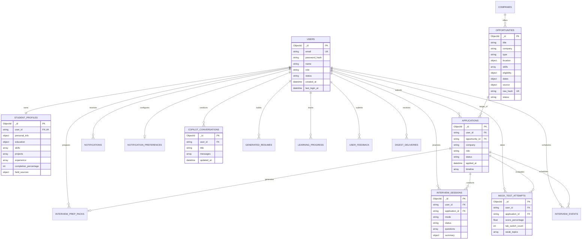

# CareerPilot AI — Complete Database Dictionary & Schema Architecture

## 1. Database Overview & Technology Design
- **Engine**: MongoDB 7.0+ (NoSQL Document Store)
- **Driver**: PyMongo 4.6+ (`pymongo.MongoClient`)
- **Database Name**: `careerpilot_ai` (Configurable via `MONGO_URI`)
- **Connection Management**: Centralized singleton `Database` class in `backend/app/config/db.py` with 2000ms server selection timeout.
- **Relational vs. Document Paradigm**: CareerPilot AI utilizes MongoDB's native document embedding for cohesive entities (e.g., student education sub-documents, project arrays, application timeline events) combined with normalized object ID references (`user_id`, `opportunity_id`, `application_id`) for high-churn independent entities (e.g., notifications, mock test attempts, copilot threads).

---

## 2. Master Collection Dictionary

| Collection Name | Model Class | Primary Purpose | Key Fields | Relationships | Indexes | Data Sensitivity |
|---|---|---|---|---|---|---|
| `users` | `UserModel` | Core user identity, credentials, roles, and account status | `_id`, `email`, `name`, `password_hash`, `role`, `status`, `created_at`, `last_login_at` | 1-to-1 with `student_profiles`, 1-to-Many with personal collections | Unique on `email`, index on `status` | **High (PII & Auth)** |
| `student_profiles` | `ProfileModel` | Detailed student academic credentials, skills, projects, and field provenance | `_id`, `user_id`, `personal_info`, `education`, `skills`, `projects`, `experience`, `completion_percentage`, `field_sources` | 1-to-1 with `users` via `user_id` | Unique on `user_id`, index on `education.graduation_year`, `skills` | **High (PII & Academic)** |
| `opportunities` | `OpportunityModel` | Live jobs, internships, hackathons, and contests ingested from external sources | `_id`, `title`, `company`, `type`, `location`, `skills`, `eligibility`, `dates`, `source`, `raw_hash`, `status` | Referenced by `applications` via `opportunity_id` | Unique sparse on `raw_hash`, compound on `source.name` + `source.external_id`, index on `status`, `dates.deadline` | **Public (Job Ads)** |
| `companies` | `CompanyModel` | Verified employer registry, domains, logos, and student watchlists | `_id`, `name`, `normalized_name`, `domain`, `industry`, `tier`, `watchlist_count` | Referenced in opportunities and recommendations | Unique on `normalized_name`, index on `domain` | **Public** |
| `applications` | `ApplicationModel` | Student job application tracking, stages, and timeline audits | `_id`, `user_id`, `opportunity_id`, `company`, `role`, `status`, `applied_at`, `notes`, `timeline` | Belongs to `users` via `user_id`, optional ref to `opportunities` | Compound on `user_id` + `status`, compound on `user_id` + `opportunity_id` | **Medium (Private Career)** |
| `interview_prep_packs` | `InterviewPrepModel` | Tailored study guides, checklists, and question banks for specific applications | `_id`, `user_id`, `application_id`, `company_name`, `role_title`, `question_bank`, `checklist`, `skill_gaps` | Belongs to `users`, linked to `applications` | Compound unique on `user_id` + `application_id` | **Low (Study Notes)** |
| `interview_sessions` | `InterviewSessionModel` | Live simulator sessions, student answers, and AI evaluations | `_id`, `user_id`, `application_id`, `mode`, `status`, `questions`, `current_question_index`, `summary` | Belongs to `users`, linked to `applications` | Compound on `user_id` + `application_id`, index on `status` | **Medium (Evaluations)** |
| `mock_test_attempts` | `MockTestAttemptModel` | Proctored exam attempts, scores, and anti-cheating diagnostics | `_id`, `user_id`, `application_id`, `score_percentage`, `tab_switch_count`, `weak_topics`, `answers` | Belongs to `users`, linked to `applications` | Compound on `user_id` + `application_id`, index on `created_at` | **Medium (Exam Scores)** |
| `copilot_conversations`| `CopilotConversationModel`| RAG chat threads between student and AI Copilot | `_id`, `user_id`, `title`, `messages` (role, content, timestamp), `created_at`, `updated_at` | Belongs to `users` via `user_id` | Compound on `user_id` + `updated_at` | **Medium (Private Advice)**|
| `advisor_conversations`| Legacy | Legacy conversational advisor logs | `_id`, `user_id`, `messages`, `created_at` | Belongs to `users` via `user_id` | Index on `user_id` | **Medium (Private)** |
| `notifications` | `NotificationModel` | In-app alerts, deadline reminders, and system notifications | `_id`, `user_id`, `type`, `title`, `message`, `data`, `read`, `created_at` | Belongs to `users` via `user_id` | Compound on `user_id` + `read`, index on `created_at` | **Low (Alerts)** |
| `notification_preferences`| `NotificationPreferenceModel`| User alert settings (in-app, email, digest frequency) | `_id`, `user_id`, `channels`, `digest_frequency`, `categories` | 1-to-1 with `users` via `user_id` | Unique on `user_id` | **Low (Settings)** |
| `digest_deliveries` | `DigestDeliveryModel` | Audit logs of daily and weekly opportunity digest dispatches | `_id`, `user_id`, `frequency`, `opportunity_ids`, `sent_at`, `status` | Belongs to `users` via `user_id` | Compound on `user_id` + `frequency` + `sent_at` | **Low (Logs)** |
| `interview_events` | `InterviewEventModel` | Calendar events for scheduled interview rounds | `_id`, `user_id`, `application_id`, `title`, `scheduled_at`, `meeting_link`, `round` | Belongs to `users`, linked to `applications` | Compound on `user_id` + `scheduled_at` | **Medium (Schedules)** |
| `learning_progress` | `LearningProgressModel` | Student progress across recommended learning resources | `_id`, `user_id`, `skill`, `resource_id`, `status`, `completed_at` | Belongs to `users` via `user_id` | Compound on `user_id` + `skill` | **Low (Progress)** |
| `user_feedback` | `FeedbackModel` | Student feedback submissions and bug reports | `_id`, `user_id`, `category`, `rating`, `comment`, `created_at` | Belongs to `users` via `user_id` | Index on `created_at`, index on `category` | **Low (Feedback)** |
| `generated_resumes` | `GeneratedResumeModel` | Tailored resumes compiled and formatted within CareerPilot | `_id`, `user_id`, `template_id`, `data`, `pdf_path`, `created_at` | Belongs to `users` via `user_id` | Compound on `user_id` + `created_at` | **High (Resume PII)** |
| `source_runs` | `SourceRunModel` | Ingestion pipeline run metrics and source telemetry | `_id`, `source_name`, `started_at`, `duration_seconds`, `metrics` (fetched, accepted, duplicates), `status` | Independent system log | Index on `source_name`, index on `started_at` | **Internal (Operational)**|
| `audit_logs` | `AuditLogModel` | Security audit trail for admin actions and account lifecycle | `_id`, `action`, `actor_id`, `target_id`, `client_ip`, `user_agent`, `details`, `timestamp` | Independent system log | Index on `action`, index on `timestamp`, index on `actor_id` | **Internal (Zero PII)** |
| `failed_file_cleanups` | Standalone | Queue of orphaned files on disk requiring administrative retry | `_id`, `file_path`, `user_id`, `error`, `failed_at`, `resolved` | Independent maintenance queue | Index on `resolved`, index on `failed_at` | **Internal (Storage)** |

---

## 3. Entity Relationship Diagram (ERD)

---

## 4. Key Relational Linkages & Data Lifecycles

### 4.1 How Users Relate to Student Profiles
- **Cardinally**: Strict 1-to-1 relationship.
- **Linkage**: `student_profiles.user_id` stores the stringified hexadecimal `ObjectId` of the matching document in `users`.
- **Initialization**: Automatically provisioned during `POST /api/auth/register`. A student cannot exist without a profile, and a profile cannot be detached from its user.

### 4.2 How Opportunities Relate to Applications
- **Cardinally**: 1-to-Many relationship.
- **Linkage**: `applications.opportunity_id` references `opportunities._id`.
- **Independence**: An application can exist independently if a student manually logs an off-campus job application (in which case `opportunity_id` is null or points to a custom manual entry). If an opportunity expires or is archived, the student's historical application record is preserved.

### 4.3 How Interview Sessions & Prep Packs Relate to Applications
- **Cardinally**: 1-to-1 (Prep Pack) and 1-to-Many (Interview Sessions).
- **Linkage**: Both store `application_id` and `user_id`. Questions are synthesized specifically by analyzing the job requirements in the application against the candidate's profile.

### 4.4 How Evidence Is Stored for Skill Gap Evaluation
- **Storage Strategy**: Embedded provenance tracking within `student_profiles`.
- **Provenance Tags**:
  - `demonstrated`: Derived from verified `projects.technologies` and `experience.responsibilities`.
  - `coursework`: Derived from verified university syllabus subjects in `education.coursework`.
  - `listed`: Derived from resume keyword arrays in `skills`.
- **Independence**: Changing target roles in `/skill-gap` dynamically evaluates these stored evidence tags in real time without mutating underlying database records.

### 4.5 Cascading Account Deletion Cleanup
When `AccountDeletionService.delete_account()` executes:
1. Deletes physical files referenced in `student_profiles.resume.filePath`.
2. Emits `delete_many({"user_id": user_id})` across all 14 personal collections.
3. Deletes root user document in `users`.
4. Shared global collections (`opportunities`, `companies`, `source_runs`) remain intact.
5. Emits an anonymized audit log entry in `audit_logs` containing zero student PII.

