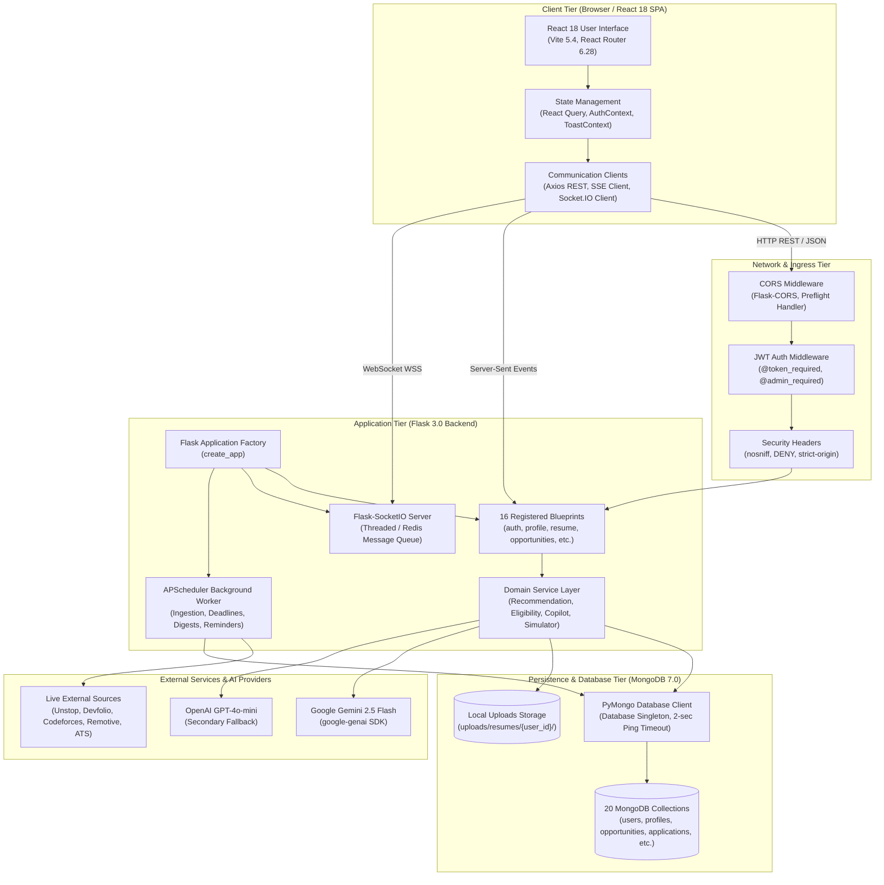
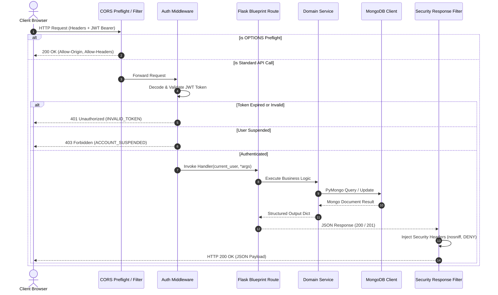
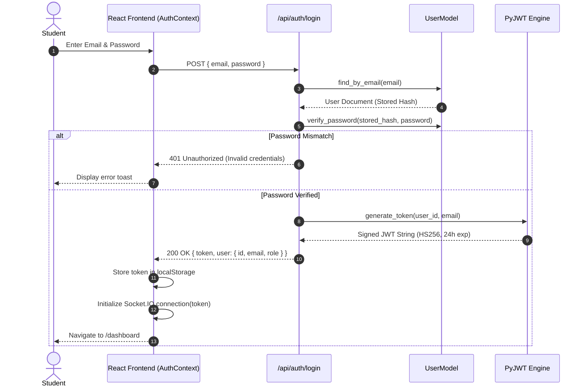
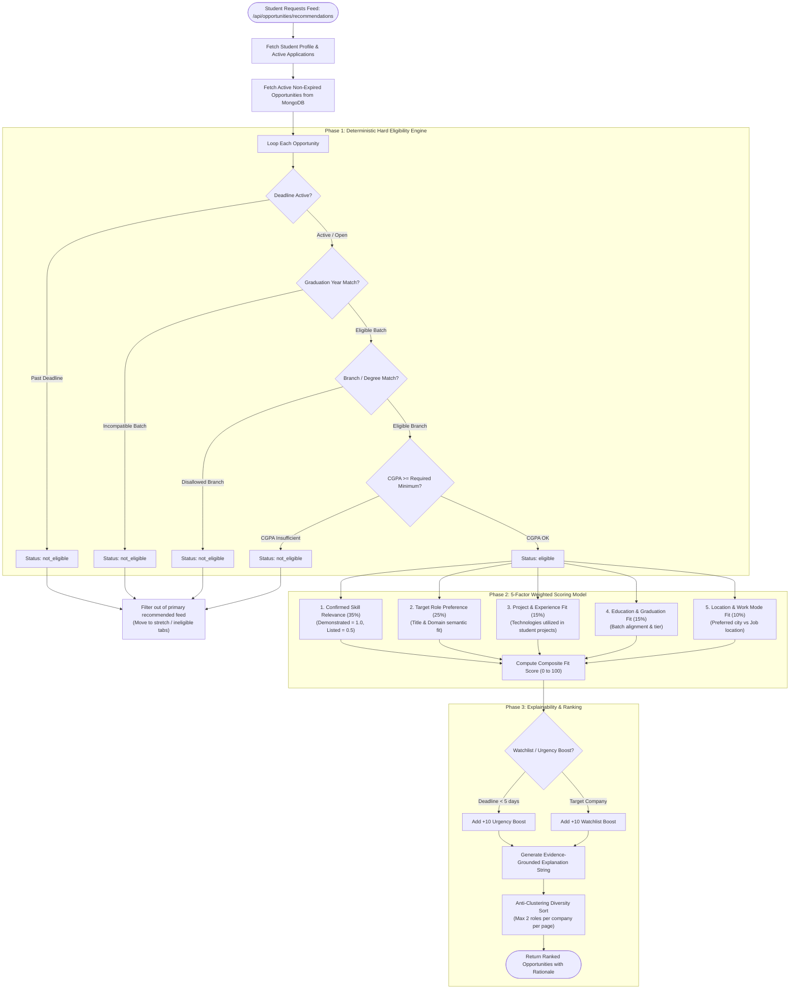
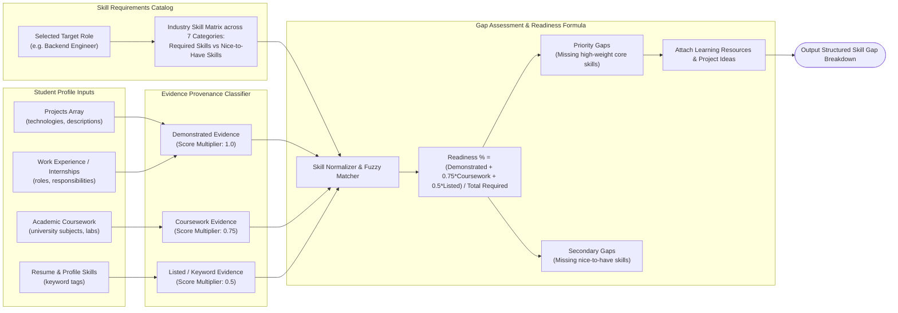
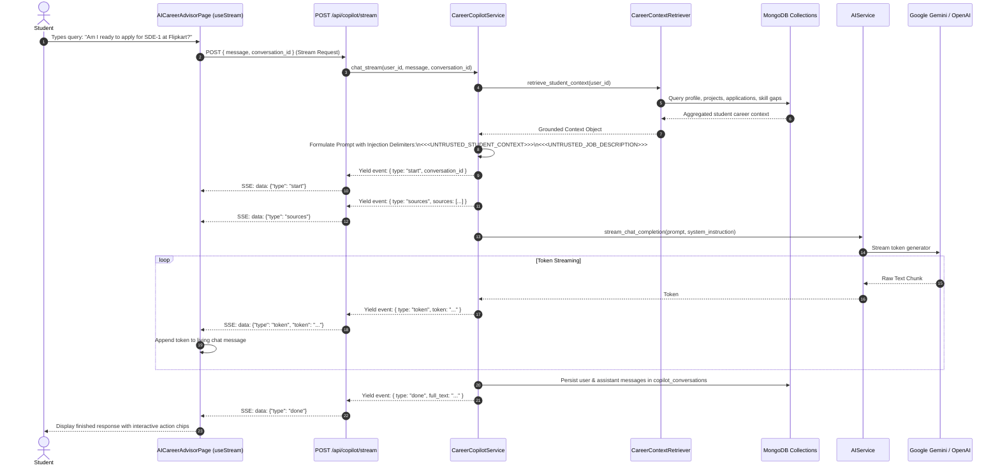
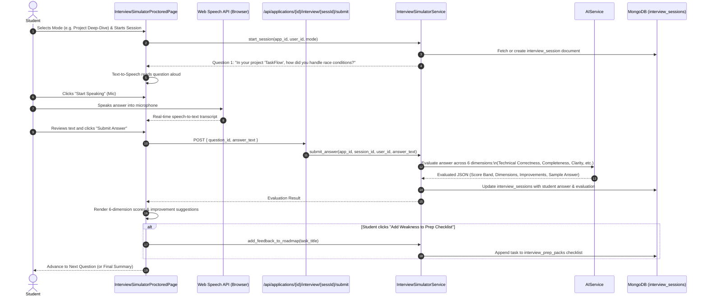
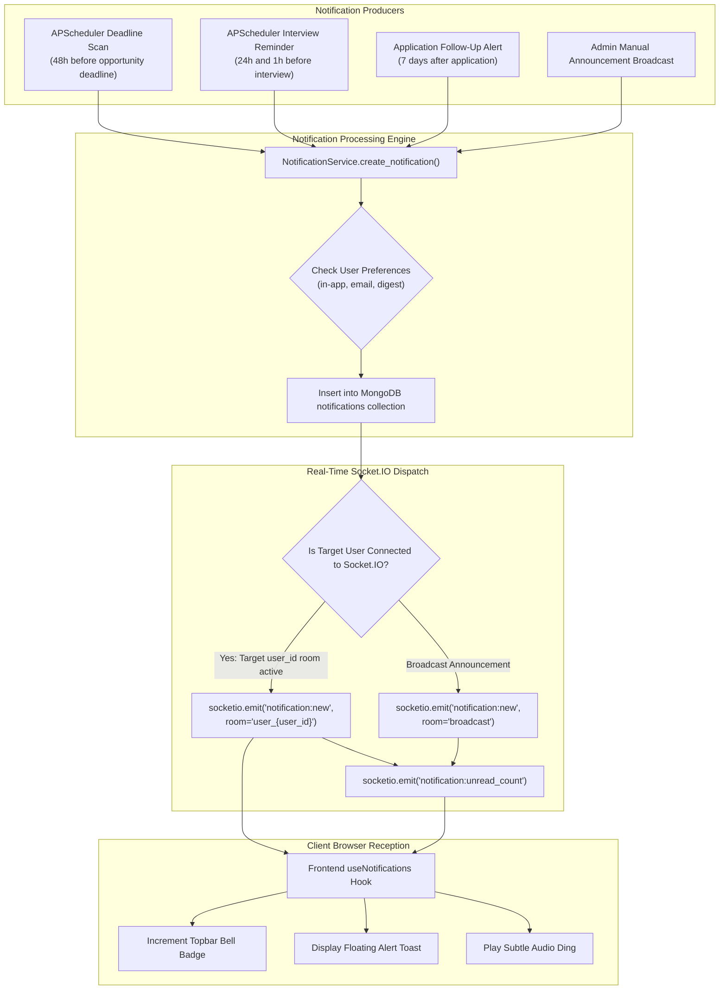

# CareerPilot AI — System Architecture & Technical Design

## 1. Architectural Principles & Overview

CareerPilot AI is engineered as a decoupled, event-driven, service-oriented web application. The platform adheres to the following core architectural principles:
1. **Separation of Concerns**: Strict boundary separation between presentation (React 18 SPA), application routing/orchestration (Flask Blueprints), domain business logic (Service Layer), persistence (PyMongo Models), and background batch processing (APScheduler).
2. **Zero-Mock Acceptance in Production**: Every user-facing feature connects to real database collections and real ingestion pipelines; test fixtures and mock generators are strictly forbidden in production code.
3. **Decoupled Eligibility & Recommendation**: Academic qualification checks (hard rules) are strictly separated from preference-based ranking (soft scores) to eliminate false eligibility recommendations.
4. **Resilient AI Orchestration**: Multi-tier provider fallback (Google Gemini 2.5 Flash -> OpenAI GPT-4o-mini -> Deterministic Rule Generators) ensuring 100% operational uptime regardless of third-party API availability or quota exhaustion.
5. **Real-Time Data Distribution**: Hybrid delivery combining stateless REST APIs, unidirectional Server-Sent Events (SSE) for opportunity and token streams, and bidirectional WebSockets (Flask-SocketIO) for private user notification rooms.

---

## 2. High-Level System Architecture Diagram



---

## 3. Frontend Architecture

### 3.1 Technology Stack & Build Pipeline
- **Core Library**: React 18.3.1 (`react`, `react-dom`) utilizing functional components and modern React Hooks (`useState`, `useEffect`, `useCallback`, `useMemo`, `useRef`).
- **Build Tool**: Vite 5.4.11 (`@vitejs/plugin-react`) delivering instant hot module replacement (HMR) and optimized ES module bundling.
- **Routing**: React Router DOM 6.28.1 supporting dynamic route matching, nested layouts (`PublicLayout`, `AppLayout`, `AdminLayout`), and declarative route guards (`ProtectedRoute`, `AdminRoute`).
- **Data Caching & Server State**: `@tanstack/react-query` 5.104.1 for cached server interactions and automatic background re-validation.
- **Animation & Motion Engine**: Framer Motion 14.0.0 providing physics-based springs, entrance stagger sequences (`staggerContainer`, `fadeUp`), and modal transitions.
- **Design System & Styling**: Custom design tokens defined in `frontend/src/index.css` paired with utility classes, Lucide React icons (0.475.0), and Recharts 3.10.1 for data visualization.
- **Real-Time Clients**: Native `EventSource` / `fetch` reader for SSE streams and `socket.io-client` 4.8.4 for push notifications.

### 3.2 Frontend Directory Structure
```
frontend/src/
├── components/          # Reusable UI widgets and feature modules
│   ├── admin/           # Admin-specific layout and navigation
│   ├── applications/    # Kanban board (DndKanbanBoard) & calendar view
│   ├── chat/            # LivingAIOrb, ChatOpportunityCard, ChatMilestone
│   ├── dashboard/       # AbekusHeroDeck, AbekusNumbersGrid
│   ├── entrance/        # Cinematic landing hero, HoloCards, ParticleBackground
│   ├── interview/       # AIInterviewSimulator components
│   ├── layout/          # AppLayout, Sidebar, Topbar, MobileBottomNav, PageContainer
│   ├── notifications/   # NotificationDropdown & badges
│   ├── opportunities/   # OpportunityCard, SwipeDeck, FeedbackWidget
│   ├── resume/          # Template renderers, ATS meter, Version drawer
│   ├── skillgap/        # Skill radar, category bars, target role arena
│   └── ui/              # Button, Card, Badge, Skeleton, Modal, ProgressRing
├── context/             # React Context providers (AuthContext, ToastContext)
├── hooks/               # Custom hooks (useAuth, useOpportunities, useStream, etc.)
├── pages/               # Top-level route pages (Dashboard, Profile, Opportunities, etc.)
├── services/            # API client wrappers (api.js, socket.js, applicationService.js)
└── utils/               # Formatting, markdown parsing, motion presets, constants
```

---

## 4. Backend Architecture

### 4.1 Application Factory & Configuration
The backend application is initialized via `create_app()` in `backend/app/__init__.py`. Configuration parameters are loaded dynamically via `backend/app/config/config.py` from environment variables with safe development defaults:

- `SECRET_KEY`: Flask session security key.
- `MONGO_URI`: MongoDB connection string (default: `mongodb://localhost:27017/careerpilot_ai`).
- `JWT_SECRET`: Signing key for JSON Web Tokens (HS256).
- `JWT_EXPIRATION_HOURS`: Token validity period (default: 24 hours).
- `GEMINI_API_KEY`: API key for Google Gemini generative services.
- `OPENAI_API_KEY`: API key for OpenAI fallback services.
- `UPLOAD_FOLDER`: File storage root on local disk (default: `backend/uploads/`).
- `MAX_CONTENT_LENGTH`: Maximum allowable HTTP upload body (10 MB).
- `ENABLE_BACKGROUND_SCHEDULER`: Toggle for APScheduler background execution.

### 4.2 Blueprint Route Architecture
The application organizes endpoints into 16 modular Flask Blueprints registered in `create_app()`:

| Blueprint Name | Module Path | Route Prefix | Primary Purpose |
|---|---|---|---|
| `health_bp` | `app.routes.health` | `/api` | System connectivity ping and service health monitoring |
| `auth_bp` | `app.routes.auth` | `/api/auth` | User registration, login, token refresh, password changes, logout |
| `profile_bp` | `app.routes.profile` | `/api/profile` | Student profile CRUD, education, skills, and account deletion |
| `resume_bp` | `app.routes.resume` | `/api/resume` | Resume upload, PDF/DOCX parsing, extraction review, and confirmation |
| `resume_builder_bp` | `app.routes.resume_builder` | `/api/resume-builder` | Generated resume management, merging, and PDF export |
| `skill_gap_bp` | `app.routes.skill_gap` | `/api/skill-gap` | Target role evaluation, coursework mapping, and readiness metrics |
| `opportunity_bp` | `app.routes.opportunity` | `/api/opportunities` | Job discovery, search, filtering, bookmarks, and detail lookups |
| `recommendations_bp`| `app.routes.recommendations`| `/api` | Personalized recommendation feed and explainable rationale |
| `application_bp` | `app.routes.application` | `/api/applications` | Kanban application tracking, stage transitions, and notes |
| `dashboard_bp` | `app.routes.dashboard` | `/api/dashboard` | Aggregated student statistics, upcoming deadlines, and metrics |
| `notification_bp` | `app.routes.notification` | `/api/notifications` | Notification list, mark as read, preferences, and digest dispatch |
| `sources_bp` | `app.routes.sources` | `/api/sources` | Ingestion source status telemetry and manual sync triggers |
| `stream_bp` | `app.routes.stream` | `/api/stream` | Real-time SSE stream pushing live opportunity updates |
| `copilot_bp` | `app.routes.copilot` | `/api/copilot` | RAG chat conversation threads and genuine SSE token streaming |
| `advisor_bp` | `app.routes.advisor` | `/api/advisor` | Legacy conversational advisor endpoint (backward compatibility) |
| `admin_bp` | `app.routes.admin` | `/api/admin` | Administrative overview, user moderation, audit logs, and settings |

---

## 5. End-to-End Architectural Workflows & Mermaid Diagrams

### 5.1 Request Lifecycle & Middleware Flow


---

### 5.2 Authentication & Token Flow


---

### 5.3 Resume Upload, Extraction & Review Workflow
```mermaid
flowchart TD
    A([Student Uploads Resume]) --> B{File Validation}
    B -->|Size > 10MB or not PDF/DOCX| C[Reject with 400 Bad Request]
    B -->|Valid Document| D[Save to Isolated Path:\nuploads/resumes/{user_id}/{filename}]
    D --> E[Record Metadata in Profile:\nfileName, filePath, analysisStatus: pending]
    E --> F[Trigger /api/resume/analyze?save=false]
    F --> G[Extract Raw Text:\npypdf or python-docx]
    G --> H[AIService Prompt Formulation:\nStructured Schema with System Safeguards]
    H --> I[Invoke Gemini 2.5 Flash]
    I -->|Success| J[Parse Structured JSON Extracted Data]
    I -->|API Failure / Timeout| K[Invoke OpenAI GPT-4o-mini Fallback]
    K -->|Failure| L[Regex-based Rule Extractor Fallback]
    J --> M[Present Interactive Diff Screen:\n/profile/review]
    K --> M
    L --> M
    M --> N[Student Selects Which Extracted Fields to Keep]
    N --> O[POST /api/resume/confirm-extraction]
    O --> P[Merge into MongoDB student_profiles:\nUpdate Provenance field_sources without overwriting manual edits]
    P --> Q([Profile Updated Successfully])
```

---

### 5.4 External Opportunity Ingestion Pipeline
```mermaid
flowchart TD
    subgraph Sched ["Scheduler Tier"]
        Timer["APScheduler (Every 6 Hours)"] --> IngestJob["OpportunityIngestionService.run_ingestion()"]
        AdminSync["POST /api/sources/sync"] --> IngestJob
    end

    subgraph Connectors ["Live External Connectors"]
        IngestJob --> C1["UnstopConnector (India University Roles)"]
        IngestJob --> C2["DevfolioConnector (Hackathons & Bounties)"]
        IngestJob --> C3["RemotiveConnector (Remote Tech Roles)"]
        IngestJob --> C4["CodeforcesConnector (Coding Contests)"]
        IngestJob --> C5["ATSJobBoardConnector (Greenhouse / Lever)"]
    end

    subgraph Processing ["Normalization & Filtering Pipeline"]
        C1 & C2 & C3 & C4 & C5 --> Norm["OpportunityNormalizer.standardize()"]
        Norm --> GeoFilter{"is_india_eligible(opp)?"}
        GeoFilter -->|No: US/EU exclusive| RejectGeo["Discard / Reject Counter++"]
        GeoFilter -->|Yes: India tech hub / Global remote| Val{"Validate Schema Required Fields"}
        Val -->|Invalid| RejectVal["Validation Failed Counter++"]
        Val -->|Valid| Dedup{"DeduplicationService.find_duplicate()"}
    end

    subgraph Deduplication ["5-Layer Deduplication Engine"]
        Dedup -->|Layer 1: Stable Source ID| FoundDup[Match Found]
        Dedup -->|Layer 2: Exact SHA-256 Hash| FoundDup
        Dedup -->|Layer 3: Canonical URL Match| FoundDup
        Dedup -->|Layer 4: Exact Org + Title + Location| FoundDup
        Dedup -->|Layer 5: Fuzzy String Match (>=0.85)| FoundDup
        Dedup -->|No Match| BrandNew[New Unique Opportunity]
    end

    subgraph Persistence ["Persistence & Broadcast"]
        FoundDup --> UpdateRec["Deterministic Field Precedence Merge\n(Update existing Mongo document)"]
        BrandNew --> InsertRec["Insert into MongoDB opportunities collection"]
        InsertRec --> SSE["EventStreamManager.broadcast()\n(Push to /api/stream/opportunities)"]
        UpdateRec --> RecordMetrics["Record SourceRunModel Telemetry"]
        InsertRec --> RecordMetrics
    end
```

---

### 5.5 Recommendation & Eligibility Evaluation Pipeline


---

### 5.6 Evidence-Based Skill Gap Computation


---

### 5.7 AI Career Copilot RAG & Streaming Architecture


---

### 5.8 AI Interview Simulator Interactive Workflow


---

### 5.9 Push Notification Delivery Architecture


---

### 5.10 Cascading Account Deletion & Permanent Data Cleanup
```mermaid
flowchart TD
    Start([Student Requests Account Deletion: /settings]) --> Input[Enter Current Password + Type 'DELETE']
    Input --> Route[DELETE /api/profile/account]
    Route --> VerifyPW{"UserModel.verify_password(pw)?"}
    VerifyPW -->|Incorrect Password| RejectPW[401 Unauthorized: Incorrect password]
    VerifyPW -->|Verified| Svc[AccountDeletionService.delete_account()]

    subgraph Stage1 ["Stage 1: Immediate Account Deactivation"]
        Svc --> Deactivate["Set user status: 'suspended', deletion_pending: true"]
        Deactivate --> TermSocket["Disconnect active Socket.IO connection:\nsocketio.emit('account:deactivated')"]
    end

    subgraph Stage2 ["Stage 2: Disk File Removal"]
        TermSocket --> FindResume["Lookup resume file path in student_profiles"]
        FindResume --> DelFile{"File exists on disk?"}
        DelFile -->|Yes| RemoveDisk["os.remove(file_path)"]
        DelFile -->|No / Error| QueueFailed["Queue in failed_file_cleanups collection for admin retry"]
    end

    subgraph Stage3 ["Stage 3: Cascading Collection Purge"]
        RemoveDisk & QueueFailed --> DelProf["db.student_profiles.delete_many({user_id})"]
        DelProf --> DelApp["db.applications.delete_many({user_id})"]
        DelApp --> DelNotif["db.notifications.delete_many({user_id})"]
        DelNotif --> DelPref["db.notification_preferences.delete_many({user_id})"]
        DelPref --> DelIEv["db.interview_events.delete_many({user_id})"]
        DelIEv --> DelIPrep["db.interview_prep_packs.delete_many({user_id})"]
        DelIPrep --> DelTest["db.mock_test_attempts.delete_many({user_id})"]
        DelTest --> DelISess["db.interview_sessions.delete_many({user_id})"]
        DelISess --> DelRes["db.generated_resumes.delete_many({user_id})"]
        DelRes --> DelLearn["db.learning_progress.delete_many({user_id})"]
        DelLearn --> DelFB["db.user_feedback.delete_many({user_id})"]
        DelFB --> DelDig["db.digest_deliveries.delete_many({user_id})"]
        DelDig --> DelCop["db.copilot_conversations.delete_many({user_id})"]
        DelCop --> DelAdv["db.advisor_conversations.delete_many({user_id})"]
    end

    subgraph Stage4 ["Stage 4: Primary Record Removal & Audit"]
        DelAdv --> DelUser["db.users.delete_one({_id: user_id})"]
        DelUser --> AnonymAudit["Record Anonymized Audit Log:\n(Zero PII: no email, no name, only role & deletion counts)"]
    end

    AnonymAudit --> Complete([Return 200 OK: Account Permanently Deleted])
```

---

## 6. External Service Integration Matrix

| External Service | Category | Integration Method | Failover / Resilience Policy | Operational Status |
|---|---|---|---|---|
| **Google Gemini 2.5 Flash** | Primary AI Provider | `google-genai` / `google.generativeai` Python SDK | 15s timeout, max 2 retries on transient errors; fast-fail on 401/429 to OpenAI fallback. | Active & Verified |
| **OpenAI GPT-4o-mini** | Secondary AI Provider | `openai` Python SDK (Chat Completions API) | 15s timeout, JSON object response format; fast-fail on 401/429 to deterministic generators. | Configured & Test Verified (Requires package in `requirements.txt`) |
| **Unstop API** | Job & Internship Discovery | Public REST endpoint (`https://unstop.com/api/public/...`) | Polite custom User-Agent, 10s timeout, circuit breaker after 3 consecutive failures. | Active Ingestion Connector |
| **Devfolio API** | Hackathon Ingestion | Public REST endpoint (`https://api.devfolio.co/api/open/...`) | Rate-limited requests, SHA-256 deduplication, non-blocking ingestion. | Active Ingestion Connector |
| **Remotive API** | Remote Tech Opportunities | Public REST endpoint (`https://remotive.com/api/remote-jobs`) | Cleaned HTML descriptions, India-eligibility validation (`is_india_eligible`). | Active Ingestion Connector |
| **Codeforces API** | Coding Competitions | Public REST endpoint (`https://codeforces.com/api/contest.list`) | Extracts upcoming competitive programming rounds with direct registration links. | Active Ingestion Connector |
| **ATS Feed Connectors** | Direct Employer Jobs | Greenhouse, Lever, SmartRecruiters, Workable endpoints | Configurable company registry in `company_registry.json`, parses official ATS job boards. | Active Ingestion Connector |
| **Local Disk Storage** | Resume Document Storage | Local filesystem (`uploads/resumes/{user_id}/`) | Isolated per-user directories, path traversal safeguards (`secure_filename`). | Active & Functional |

